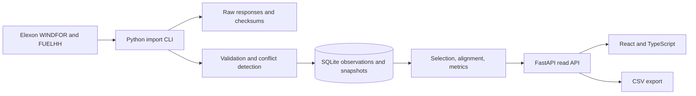
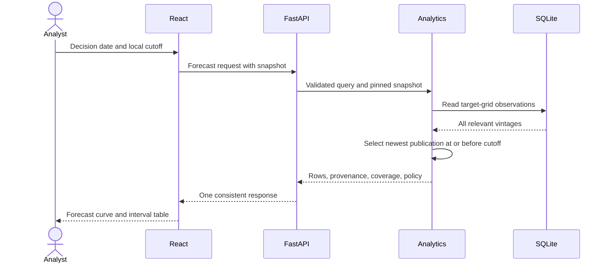

# Architecture: wind forecast decision support

Version: 0.1. Date: 27 October 2026. Status: local analytical architecture, Docker package and read-only Vercel production deployment verified in their tested scopes. Live and synthetic snapshots, analytical APIs, export, and integrated React views are present. [Release validation](RELEASE_VALIDATION.md) records local tests; [assignment audit](ASSIGNMENT_AUDIT.md) records hosted checks and limits.

Requirements: [PRD](PRD.md). Sources: [research](SOURCE_RESEARCH.md). Rationale: [ADR-001](decisions/0001-mvp-baseline.md). Task order: [implementation plan](IMPLEMENTATION_PLAN.md).

## 1. Design approach

Use a modular Python backend, a React frontend, and a local SQLite database. A separate import command downloads and validates source data. Web requests operate on a pinned local snapshot and never contact Elexon. This keeps a January replay reproducible and lets the demonstration work without internet after setup.



No microservices, message broker, Redis, model training, background scheduler, or cloud database is needed for this assignment. [ADR-003](decisions/0003-vercel-container-delivery.md) records the Vercel delivery choice: one reviewed January SQLite snapshot is immutable, read-only input inside a single Docker image. The image serves the built React UI and FastAPI from one HTTP port; source refresh still happens outside web requests and requires a new reviewed image. This is an assignment demonstration design, not a durable multi-user ingestion service.

## 2. Components and code boundaries

| Component | Responsibility | Must not do |
| --- | --- | --- |
| Source adapter | Construct supported query parameters; download with timeouts and bounded retries | Select a historical forecast using a latest-only source default |
| Ingestion service | Validate source rows, retain raw input, classify conflicts, publish snapshots | Mutate an existing published snapshot |
| Repository | Query snapshot membership and normalized observations | Decide cutoff or error sign |
| Selection service | Build the target grid and choose eligible vintages | Use post-cutoff publications or silently fall back from a conflicting newest vintage |
| Alignment service | Apply a named, validated comparison policy | Infer that timestamp cadence proves interval-average semantics |
| Metrics service | Compute statistics from matched rows | Fill gaps or round inputs before calculation |
| FastAPI | Validate queries and serialize one analytical response contract | Start source ingestion from browser requests |
| React | Controls, charts, accessible tables, errors, export link | Reimplement selection or metrics |

The Python 3.12 lock pins FastAPI, Uvicorn, httpx, SQLAlchemy, Alembic, pytest, and Ruff. The frontend lock pins React, TypeScript, Vite, Sass, Vitest, Playwright, and axe tooling. The analytical service uses the standard library for selection and metrics; responsive SVG charts render stored API values. SQLite plus SQLAlchemy provides a versioned local schema, without implying a tested migration to another database.

Proposed layout:

```text
backend/
  pyproject.toml
  src/gridbricks/
    main.py
    config.py
    api/{forecast,accuracy,status,export}.py
    sources/elexon.py
    ingestion/{service,validation}.py
    storage/{models,repository}.py
    analytics/{grid,selection,alignment,metrics}.py
    cli.py
  migrations/
  tests/{unit,integration,fixtures}/
frontend/
  src/
    api/
    components/
    pages/{DecisionView,AccuracyView,DataStatus}.tsx
    types/
  tests/
data/{raw,snapshots}/
docs/
Makefile
```

The layout is the implemented component boundary; individual file names may differ from this conceptual view. `src/gridbricks` is an installable backend package with a separate import CLI, storage, analytics, and read-only HTTP API.

## 3. Source acquisition and validation

Base URL: `https://data.elexon.co.uk/bmrs/api/v1`.

| Dataset | Required path | Query strategy |
| --- | --- | --- |
| WINDFOR | `/datasets/WINDFOR/stream` | Set `publishDateTimeFrom` and `publishDateTimeTo`; local filtering enforces boundaries |
| FUELHH | `/datasets/FUELHH/stream` | Prefer `settlementDateFrom`, `settlementDateTo`, and `fuelType=WIND` for delivery coverage; also filter WIND locally |

The official schema allows FUELHH settlement-date or publication-time filters, but not both together. Audit parameter inclusivity and late revisions in T01. A publication-window sample is not a delivery-window backfill. [Official schema](https://data.elexon.co.uk/swagger/v1/swagger.json)

Start forecast discovery with 2025-12-25T00:00:00Z through 2026-02-01T00:00:00Z, in daily publication windows. This is a proposed seven-day lookback before the first decision, not proof that all older history is irrelevant. T01 determines whether to extend it. Retain the searched bounds; mark unresolved leading coverage as `history_window_exhausted`, rather than asserting that the source never published a forecast.

Fetch actual settlement dates covering 2 January through 1 February. Overfetch adjacent boundaries if source inclusivity requires it; then locally restrict targets to `[2026-01-02T00:00:00Z, 2026-02-02T00:00:00Z)`. January's London timezone is UTC, but derive bounds using timezone conversion rather than hardcoding the offset. Check every requested delivery date, including the final half-hour. Missing or delayed outturn remains explicit.

Ingestion sequence:

1. Create an ingestion run and record dataset, request parameters, code version, and query bounds.
2. Fetch with proposed 20-second request timeout, at most three attempts total, exponential backoff and jitter. Honor `Retry-After` within a documented bounded retry budget; otherwise fail the window. Retry transport failures, 429, and transient 5xx; fail ordinary 4xx without blind retry.
3. Save bytes and SHA-256 before parsing. Do not log full bodies by default.
4. Parse timestamps to UTC, require expected dataset and fields, require finite numeric generation, and validate timestamps against source cadence. Zero is valid. Flag unusual signed values for source review; never clamp values or silently rewrite units.
5. Normalize and retain observations; deduplicate exact semantic rows and identify same-key value conflicts. Keep invalid-row counts and reasons. A malformed payload or unknown schema fails publication, while recognized row-level defects may yield a visibly partial candidate snapshot.
6. Build a manifest, including raw hashes, observation membership, query coverage, policy versions, and quality counts.
7. Atomically publish the candidate and switch the active pointer only after validation. Intentional partial snapshots must be labelled partial; a failed run leaves the prior pointer unchanged.

## 4. Data model and snapshot reproducibility

| Table | Main fields | Constraints and purpose |
| --- | --- | --- |
| `ingestion_runs` | id, dataset, parameters_json, started_at, completed_at, status, counts_json, error_code | Status `running`, `succeeded`, `partial`, or `failed`; source request provenance |
| `raw_responses` | id, run_id, request_url, retrieved_at, content_hash, relative_path, http_status | Immutable local response reference |
| `observations` | id, dataset, start_time_utc, publish_time_utc, generation_mw, fuel_type, semantic_hash, quality_flags_json | Unique semantic_hash; source key may have multiple conflicting values |
| `observation_sources` | observation_id, raw_response_id, row_index | Many-to-many lineage, including repeated downloads |
| `snapshots` | id, input_hash, manifest_hash, created_at, bounds_json, status, policy_versions_json, manifest_path | Immutable input identity, audit manifest, and completeness |
| `snapshot_observations` | snapshot_id, observation_id | Composite unique key fixes the exact input set |
| `app_state` | key, value | Active snapshot pointer; switched in a transaction |

Index observations by `(dataset, start_time_utc, publish_time_utc)` and snapshot membership by `(snapshot_id, observation_id)`. Store UTC timestamps in one canonical, fixed-width format and compare parsed times in analytics. Use double precision for calculations, retain the original numeric representation in raw input, and disallow nonfinite values. Round only in the UI.

Do not place a unique constraint on target/publication alone: it would erase same-key conflicts. A snapshot's membership must be fixed; a timestamp such as `retrieved_at <= snapshot_time` is not a substitute for immutable membership. A request pins the active snapshot once at its start. Subsequent browser queries and exports pass its ID explicitly, so a refresh cannot mix input sets.

Compute `input_hash` from a canonical ordered representation of semantic observation hashes, raw payload hashes, source bounds, and policy versions. Exclude retrieval times, run IDs, local database IDs, and snapshot creation times from that input identity. The separate `manifest_hash` covers the full audit manifest, which includes retrieval provenance and may differ across otherwise identical imports. Tests compare input identity and analytical results without requiring audit timestamps to remain fixed.

## 5. Selection, actual reference, and alignment



For decision date d, create the next local day's target grid, then convert it to UTC. Construct the cutoff using `zoneinfo.ZoneInfo("Europe/London")`; never use the computer's local timezone. Public queries are restricted to January 2026, so DST transition dates are outside this release. Do not generalize to all years without transition-day tests.

For each target, consider snapshot forecast records with `publish_time <= cutoff`. Find the maximal publication time, then assess that publication for uniqueness. If it has conflicting values, return `forecast_conflict`; do not pick by insertion order or fall back silently. Do not restrict eligible records to publication on d. Preserve the selected publication ID and lead time.

For retrospective actuals, choose the greatest publication time per constituent actual interval present in the same pinned snapshot. A conflicting greatest publication produces `actual_conflict`. Actuals may be published after the decision because this is explicitly retrospective evaluation. This is not a simulation of actual-data availability at the decision.

Alignment policy `timestamp_matched_halfhour_reference_v1` is adopted in [ADR-002](decisions/0002-timestamp-matched-reference.md). Match each WINDFOR target at t with exactly one FUELHH WIND half-hour starting at t, retaining its value, publication, observation ID and raw lineage. The next half-hour remains stored but does not fill or alter this reference. No interpolation, nearest-time join, forward fill or forecast duplication is allowed. Keep `temporal_reference_mismatch` on comparison rows and label the benchmark visibly: physical averaging equivalence is unverified. `target_end` is the hourly display-grid boundary only.

Hourly-average semantics remain unverified and `hourly_average_v1` is unsupported. Accuracy uses only the adopted timestamp-reference policy recorded by its immutable snapshot; unknown or unverified policies return 409 `alignment_unverified`. Governing documents are revised before this implementation activates. Do not fabricate MWh or an hourly mean from cadence alone.

## 6. Metrics and missingness

Use the PRD equations. Compute one matched-row vector per request. Charts, aggregate cards, breakdowns, and CSV all derive from that vector and the same full expected grid. Counts are unrounded integers; metrics are unrounded finite numbers or null. A completed January import can still have missing source intervals.

Primary row states, evaluated in this order: `forecast_conflict`, `history_window_exhausted`, `missing_forecast`, `actual_conflict`, `missing_actual`, `matched`. Retain additional flags so one primary category does not hide other defects. The actual dimension applies only in retrospective responses. Return counts whose primary categories sum to expected_count.

Provide forecast-selected count, complete-actual count, matched count, and expected count separately. Monthly MAE and bias use all matched rows; monthly RMSE is the square root of the pooled squared-error mean. For optional p90, use NumPy's linear quantile convention and record the metric policy version. No weighted averaging of rounded cards.

## 7. API contract

All paths are read-only GET routes under `/api/v1`. Required user inputs are local dates and `cutoff=HH:MM`; timezone is fixed to Europe/London in v1. Snapshot is optional only for the first request. Reject unknown or inconsistent parameters rather than silently ignoring them.

Two local convenience routes are outside that versioned path: `GET /` redirects to the Vite UI on `127.0.0.1:5173`, and `GET /health` aliases the process-only `/api/v1/health` response. Neither touches source data or storage. The redirect assumes the documented local development ports and is not a public-hosting contract.

| Route | Parameters | Result |
| --- | --- | --- |
| `/health` | none | Process health; not a data-completeness claim |
| `/data-status` | optional snapshot_id | Active snapshot, covered dates, policies, import outcome and quality |
| `/forecast` | decision_date, cutoff, optional snapshot_id | Next-day forecast grid; selected timestamps and gaps; no future actuals |
| `/accuracy` | decision_from, decision_to, cutoff, optional snapshot_id | Retrospective aligned rows, aggregate and daily metrics |
| `/forecast/revisions` | decision_date, target_start, cutoff, optional snapshot_id | Implemented eligible-only backend route; UI viewer is a deferred Should feature |
| `/export` | view=forecast or accuracy, corresponding date parameters, cutoff, snapshot_id | CSV of the same grid and provenance as the chosen view |

Proposed JSON envelope:

```json
{
  "meta": {
    "snapshot_id": "example-snapshot",
    "decision_from": "2026-01-15",
    "decision_to": "2026-01-15",
    "cutoff_local": "09:30",
    "timezone": "Europe/London",
    "comparison_resolution_minutes": 60,
    "selection_policy": "asof_per_target_v1",
    "alignment_policy": "timestamp_matched_halfhour_reference_v1",
    "actual_policy": "latest_in_snapshot_v1",
    "metric_policy": "pooled_errors_v1",
    "evaluation_mode": "retrospective",
    "unit": "MW"
  },
  "coverage": {
    "expected_count": 24,
    "forecast_selected_count": 24,
    "complete_actual_count": 24,
    "matched_count": 24,
    "matched_fraction": 1.0,
    "reason_counts": {"matched": 24}
  },
  "metrics": {"mae_mw": 20.0, "rmse_mw": 20.0, "bias_mw": 0.0},
  "rows": []
}
```

The envelope above is a synthetic contract illustration, not measured data; rows are omitted. The 60-minute resolution describes forecast grid spacing, not an hourly actual average. Each accuracy row includes decision date, UTC cutoff, target start/end, forecast value/publication/observation ID, exact-time half-hour actual reference, constituent references, error, primary state, and flags. The forecast route omits actuals and error. Historical source publication, retrieval time, cutoff, age-at-cutoff, and lead time have distinct names.

Errors use `{ "error": { "code": "...", "message": "...", "details": {} } }`. Return 422 for invalid inputs or unsupported January bounds, 404 for an unknown snapshot, 503 `dataset_unavailable` when no usable snapshot exists, and 409 `alignment_unverified` for accuracy requests before the comparison contract is resolved. A valid sparse dataset returns 200 with null metrics and explicit coverage; no observations is not a fabricated zero-error success.

CSV uses stable column names, ISO UTC timestamps, UTF-8, and consistent ordering by decision date then target start. Include all requested target rows, including gaps. Flatten constituent actual provenance to named columns. Numeric fields remain numeric; escape spreadsheet-formula prefixes in any free-text source field. Export requires a snapshot ID and reuses the same analytics service as JSON.

## 8. Frontend behavior

Keep decision date/range, cutoff, view, and snapshot in shareable URL state. The default date is a January date supported by the active snapshot, not today's date. Show derived delivery dates beside decision dates. Cancel or ignore superseded requests so an old response cannot overwrite a newer cutoff selection.

Decision view: forecast line, interval table, publication/age tooltip, completeness, export. Accuracy view: forecast and actual lines, signed error bars around zero, metric cards, daily table, retrospective label, coverage and missing reasons. Source status is a panel rather than an administrative ingestion screen. Charts use gaps for nulls and have table equivalents. Labels, focus states, and text must carry meaning without color alone. Show an age value; no arbitrary age threshold becomes a trading recommendation.

The user authorized work from [the mockup](../design/ui-mockup.html), documented in [UI_DESIGN.md](UI_DESIGN.md). Decision and Accuracy request a pinned stored snapshot, render selected vintages and retrospective reference values, show provenance and coverage, and export the same rows as CSV. The later user instruction removed the interactive mockup preview from the app. Application styling uses SCSS tokens and nesting. Finite SVG animations respect reduced motion, and interval tables are paginated to bound DOM size.

## 9. Local operation, security, and diagnostics

Proposed development ports are frontend 5173 and backend 8000. Vite proxies `/api` to FastAPI. Bind the local app to loopback by default; allow only explicit development origins. No source secrets or client data are needed for the demonstrated public-data requests. Keep ingestion as a local CLI rather than a writable web route. Do not imply this local design is ready for internet deployment.

Use structured logs with request ID, snapshot, query bounds, duration, and error code. Import logs add dataset, window, attempts, record/defect counts, and manifest ID. Log retrieval failures separately from missing source records. Add a network-disabled fixture mode. Read responses from SQLite, with a proposed p95 <= 1 second local response target measured as specified in the PRD; no cache is necessary initially.

The hosted immutable-snapshot build now sets `GRIDBRICKS_IMMUTABLE_DEPLOYMENT=1`. In that mode, successful `GET`/`HEAD` responses for data status and explicitly pinned forecast, accuracy and export requests allow one hour of CDN caching while asking browsers to revalidate. The built HTML has the same CDN lifetime; content-hashed Vite assets are immutable for one year. Health, errors, unpinned analytical requests and the normal local API keep `Cache-Control: no-store`. The Docker build verifies and packages the snapshot; a changed dataset requires a new deployment. `X-Request-ID` on a CDN hit identifies the origin response that populated the cache, so it may repeat across hits and may not match a new origin log event for each viewer.

Implemented locally: the API emits JSON-line `http_request` events to stderr and returns the generated ID in `X-Request-ID`. Logs contain allowlisted routes and validated query context, never raw URLs or source payloads. The import CLI emits per-window start, completion and failure events, plus publication with snapshot and manifest hash. A failed retrieval has a distinct event from a missing observation. [Backend verification](BACKEND_TEST_REPORT.md#structured-logging-follow-up-verified) covers owned-process output and the post-change benchmark.

The current API adds trusted loopback hosts, a 2KB raw-query cap, safe response headers, generic internal errors, and disabled unused documentation routes. CORS origins remain the explicit development origins. The production frontend serves a strict self-only CSP with no inline/eval scripts; development omits CSP for Vite HMR but retains the other safe document headers. Dependency scripts are disabled through `.npmrc`; backend and frontend dependency audits are recorded separately. These local controls do not constitute public-hosting readiness. See [security review](SECURITY_REVIEW.md).

## 10. Verification strategy and limits

Unit tests cover time boundaries, selection, ties/conflicts, actual revision policy, alignment, missingness, and equations. Integration tests cover adapter requests, retry behavior, atomic snapshot switching, pinned membership, API validation, and CSV/JSON parity. A browser flow changes cutoff with out-of-order responses and proves the display follows the latest query.

Source access and the comparison decision are recorded in [source-contract research](T01_SOURCE_CONTRACT.md), [comparison research](COMPARISON_POLICY.md), and [ADR-002](decisions/0002-timestamp-matched-reference.md). [Live January evidence](evidence/elexon-january-import.json), [API benchmark](evidence/api-benchmark.json), [UI validation](UI_VALIDATION.md), and [security review](SECURITY_REVIEW.md) separate provider observations, deterministic tests, browser behavior, and security probes. The [assignment audit](ASSIGNMENT_AUDIT.md) records the verified public deployment. Physical WINDFOR averaging equivalence, exhaustive historical revision availability, complete accessibility conformance, and long-term hosted availability remain unverified.
