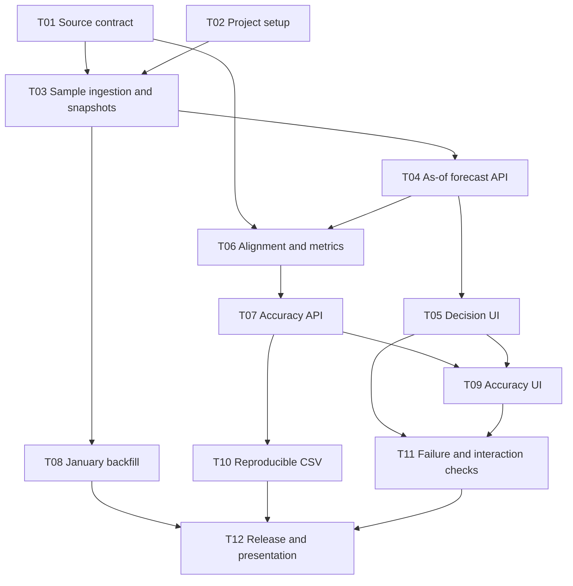

# Implementation plan: wind forecast assignment

Version: 0.1. Date: 26 October 2026. Status: T01-T12 local analytical baseline verified; assignment delivery remains partial. [todo](../todo.md) tracks acceptance evidence and unresolved limits.

The plan implements [PRD](PRD.md) using [architecture](ARCHITECTURE.md). [Research](SOURCE_RESEARCH.md) records the evidence already collected; that evidence is reconnaissance, not a completed source-contract task.

## 1. Execution rules and dependency order

Build a reproducible one-day workflow before a month-wide interface. Complete each task's acceptance criteria and relevant tests before dependent work. Preserve all Must requirements; Should requirements are explicitly deferrable and must be reported as such.

Use the proposed defaults in the PRD without inventing client approval. Setup and forecast exploration may proceed while source interval semantics are investigated. Accuracy alignment and energy interpretation must wait for evidence, not for an arbitrary approval ceremony. If a decision changes, update the PRD, architecture, ADR, fixtures, and affected acceptance criteria together.

T01 and T02 are logically independent. The user authorized implementation with a manager and frontend/backend/testing agents, then requested a frontend hold. Their later instruction to build from the supplied mockups lifts that hold and authorizes UI-first preview work before the analytical APIs. [UI_DESIGN.md](UI_DESIGN.md) records this sequencing change, SCSS, responsive animation, and the security-testing request. It does not waive T05/T09/T11 data-integration acceptance. Git initialization, commits, and publication have not been performed.

| Milestone | Tasks | Reviewable outcome |
| --- | --- | --- |
| M1 | T01-T05 | Source findings and one-day forecast replay in the browser |
| M2 | T06-T07 | Tested retrospective comparison with an explicit alignment policy |
| M3 | T08-T10 | January audit, accuracy screen, and reproducible CSV export |
| M4 | T11-T12 | Verified failure states, release evidence, and both presentations |

## 2. Planned development commands

The commands below now exist in the [Makefile](../Makefile). Browser and runtime checks use stored fixture snapshots; the live January import and API benchmark have separate evidence. See README for run order and evidence. Never mark a task verified merely because its command is listed here.

| Command | Introduced | Intended behavior |
| --- | --- | --- |
| `make setup` | T02 | Create backend virtual environment; install locked Python and frontend dependencies |
| `make backend-dev` / `make frontend-dev` | T02 | Start FastAPI on loopback 8000 and Vite on 5173 |
| `make check` | T02 | Backend lint, frontend lint/typecheck, unit/integration tests, frontend build; no network required |
| `make migrate` | T03 | Apply versioned SQLite migrations |
| `make ingest-sample` | T03 | Import source data needed for decision 2026-01-15 and delivery 2026-01-16 |
| `make ingest-fixtures` | T03 | Build a deterministic local snapshot from checked-in fixtures without network |
| `make ingest-january` | T08 | Import all configured January decisions and associated delivery coverage |
| `make audit-january` | T08 | Produce completeness, conflicts, source bounds, snapshot, and policy report |
| `make test-browser` | T05, extended later | Run Playwright against managed local servers and a fixture snapshot |
| `make benchmark-api` | T12 | Record 100 warm sequential January-range requests and p95 on a named machine |

Use backend tests through `backend/.venv/bin/python -m pytest backend/tests/...`. Make setup must make imports work from the repository root, for example by installing the backend package in editable mode. Each proposed test path below is created by its owning task. Fixture data comes from that task's explicit setup; no unspecified database or remote ID may be required.

## 3. Tasks

### T01: Validate the source and comparison contract

Goal: resolve the highest-risk domain assumptions before implementing accuracy.

Context: A01-A08, FR02, FR06, and FR11; the saved audits confirm source access, not the full physical meaning of an hourly forecast.

Approach: review the official schema and source explanations; inspect 15 January forecasts and 16 January actuals, then check first/last required delivery days. Verify filter inclusivity, source coverage, timestamp meaning, cadence, same-key duplicates, actual revisions, and enough forecast lookback. Record a named comparison policy and its evidence in research and ADR. The source did not establish hourly-average semantics, so ADR-002 adopts a visibly limited timestamp-reference benchmark rather than claiming a physical hourly average.

Acceptance:

- A source-contract note resolves or explicitly leaves open each research question, with URLs and real example records.
- A test-fixture specification defines cutoff boundaries, complete/missing hourly constituents, and conflict handling without treating synthetic values as source observations.
- The chosen comparison policy and date scope agree across all documents. T06 may proceed under ADR-002's exact-time benchmark while keeping physical averaging equivalence unverified and visible in every accuracy result.

Spec: full; PRD section 5 and architecture sections 3-5.

Verify now: `python3 -m json.tool docs/evidence/elexon-api-contract-audit.json > /dev/null` and `python3 -m json.tool docs/evidence/elexon-sample-audit.json > /dev/null`. Then reproduce the read-only requests in the research document and inspect the recorded comparison-policy evidence. JSON validity alone does not satisfy this task.

Out of scope: alternate datasets, forecasting models, or claiming a full-month backfill.

### T02: Create a runnable project and test foundation

Goal: one-command local setup with React and Python health smoke tests.

Context: NFR05 and architecture sections 2 and 9; may proceed before T01 is resolved.

Approach: scaffold FastAPI and Vite/React/TypeScript, pin dependencies, define environment examples, create Makefile targets, configure pytest and frontend checks, and add a backend health endpoint. Use a frontend API proxy and explicit loopback defaults. Add `.gitignore` for virtual environments, dependencies, generated database/raw runtime data, and secrets while retaining intentional tiny test fixtures.

Acceptance:

- `make setup` succeeds from a clean supported machine using documented prerequisites and no API key.
- A health test, frontend smoke test, and production frontend build pass.
- README clearly separates implemented commands from future commands; no simulated analytics appears as real data.

Spec: short; architecture sections 2 and 9.

Verify: `make setup`; `make check`; `backend/.venv/bin/python -m pytest backend/tests/integration/test_health.py`.

### T03: Import one decision day's data into an immutable snapshot

Goal: reproducible data for the 15 January decision and 16 January delivery.

Dependencies: T01 source parameter findings and T02. Alignment need not be resolved for ingestion.

Approach: implement the adapter, schema migrations, raw hashes, observation lineage, validation, exact deduplication, conflict retention, snapshot membership, and atomic active-pointer switch. Add live sample and offline fixture import commands. Include earlier forecast publications and all target-day actual half-hours using the validated filters.

Acceptance:

- Sample import preserves all vintages and source provenance; rerunning identical input does not duplicate semantic observations.
- A transport/schema failure cannot replace a valid active snapshot; recognized missing source rows produce labelled partial coverage.
- A fixture snapshot imports without network and retains conflicting records for later analytical handling.

Spec: full; architecture sections 3-4.

Verify: `make migrate`; `make ingest-fixtures`; `backend/.venv/bin/python -m pytest backend/tests/integration/test_ingestion.py backend/tests/integration/test_snapshots.py`; `make ingest-sample` as a separate live-source check.

### T04: Serve the one-day forecast as it stood at cutoff

Goal: a correct `/api/v1/forecast` response with target grid and provenance.

Dependency: T03. Requirements: FR01-FR04 and FR11.

Approach: implement date validation, Europe/London cutoff construction, target grid, maximal eligible publication selection, conservative conflict handling, and data-status route. Introduce synthetic fixture `cutoff_revisions.json` containing 08:30 and 10:30 vintages of the same next-day target, plus an exact-cutoff case and an older-day publication.

Acceptance:

- A 09:30 cutoff selects 100 MW from the 08:30 fixture, excluding the 140 MW 10:30 revision; a publication exactly at 09:30 is eligible.
- The API retains missing/conflicting grid rows and distinguishes selected publication age from lead time.
- Queries pin one snapshot; invalid January bounds return the documented error.

Spec: full; PRD section 5 and architecture sections 5 and 7.

Verify: `backend/.venv/bin/python -m pytest backend/tests/unit/test_selection.py backend/tests/unit/test_grid.py backend/tests/integration/test_forecast_api.py`.

### T05: Build the one-day decision interface

Goal: complete the first visible vertical slice.

Dependencies: T02 and T04. Requirements: FR01-FR04 and NFR01.

Approach: implement decision-date/cutoff controls, URL state, derived delivery date, source/snapshot details, forecast chart, interval table, gaps, and loading/empty states. Add Playwright infrastructure with fixture import and managed local servers.

Acceptance:

- An analyst can change date/cutoff, inspect each selected publication, and read missing reasons in a keyboard-accessible table.
- Displayed values come from the API and match the fixture's selected vintage.
- A post-cutoff publication and future actuals are absent from the decision view.

Spec: short; PRD sections 4 and 6 and architecture section 8.

Verify: `npm --prefix frontend run test -- --run`; `make test-browser` with the decision-flow case; `make check`.

### T06: Implement validated alignment and error calculations

Goal: a tested, independent analytics layer.

Dependencies: T01 comparison-policy resolution and T04. Requirements: FR06-FR08. [ADR-002](decisions/0002-timestamp-matched-reference.md) now adopts the timestamp-matched half-hour reference benchmark, with physical averaging equivalence explicitly unverified.

Approach: choose retrospective actual revisions within the snapshot, align with the agreed policy, and compute pooled MAE/RMSE/bias and coverage. Create `metrics_known_values.json`: forecasts [100, 200], actuals [80, 220]. Add actual-constituent fixtures for complete, missing, conflicting, and revised half-hours.

Acceptance:

- The known-values fixture yields MAE 20 MW, RMSE 20 MW, bias 0 MW; all-missing input yields null metrics and zero matched count.
- The adopted exact-time half-hour reference requires one constituent at the forecast target timestamp; adjacent half-hours cannot substitute or change it. No forecast is counted twice. Actual provenance and `temporal_reference_mismatch` survive, and UI/API/export label the benchmark limitation. `hourly_average_v1` remains unsupported.
- Monthly aggregation pools intervals and handles days with different matched counts correctly.

Spec: full; PRD section 5 and architecture sections 5-6.

Verify: `backend/.venv/bin/python -m pytest backend/tests/unit/test_alignment.py backend/tests/unit/test_metrics.py backend/tests/unit/test_actual_reference.py`.

### T07: Expose retrospective accuracy and daily breakdowns

Goal: one backend result powers cards, charts, tables, and later exports.

Dependency: T06. Requirements: FR06-FR09, FR11, FR14.

Approach: implement `/api/v1/accuracy`, validate bounded date ranges, select each day's own cutoff, and return the documented envelope. Include missingness reasons and an explicit retrospective label. Test snapshot pinning and `alignment_unverified` behavior.

Acceptance:

- Range results use individual decision cutoffs and next-day targets, including 31 January to 1 February.
- Counts reconcile to the expected grid and metrics use exactly the returned matched rows.
- Invalid input, no dataset, unresolved alignment, and valid sparse data have distinct documented responses.

Spec: full; architecture sections 6-7.

Verify: `backend/.venv/bin/python -m pytest backend/tests/integration/test_accuracy_api.py backend/tests/integration/test_snapshot_pinning.py`.

### T08: Backfill and audit the full January decision scope

Goal: a pinned January snapshot with an honest completeness report.

Dependencies: T01 and T03; may run before the full UI exists. Requirements: FR11, FR13.

Approach: implement resumable windowed import for the configured bounds, including prior forecast publications and 1 February delivery. Record per-window success/failure, requested history extent, exact input hashes, and manifest. Add a stable fixture month with deliberate gaps for offline tests.

Acceptance:

- Every requested window has an outcome; missing source records are distinguished from failed retrievals.
- Report expected, observed, valid, selected, matched, conflicting, and missing counts where the comparison policy is available; never claim 100% without evidence.
- Reimporting identical fixture inputs produces identical analytical results and the same content-based input identity.

Spec: short; architecture sections 3-4 and PRD A01-A08.

Verify: `backend/.venv/bin/python -m pytest backend/tests/integration/test_month_backfill.py`; `make ingest-january`; `make audit-january`. Live import failure does not invalidate deterministic tests, but must remain a reported release limitation.

### T09: Build the accuracy workflow

Goal: make historical forecast errors understandable.

Dependencies: T05 and T07. Requirements: FR06-FR09 and NFR01.

Approach: add date range controls, forecast/outturn chart, signed errors, MAE/RMSE/bias cards, daily table, coverage reasons, and retrospective labels. Keep snapshot and cutoff visible. Add null and single-sample states.

Acceptance:

- Charts, cards, and daily table reflect the same query and snapshot, with MW and error sign explained.
- Missing observations create gaps and explicit unavailable metrics; zero wind remains a plotted zero.
- The user can navigate controls and inspect chart values through the equivalent table using a keyboard.

Spec: short; PRD sections 4-6.

Verify: `npm --prefix frontend run test -- --run`; `make test-browser` with the accuracy-flow case; `make check`.

### T10: Export reproducible analytical rows

Goal: allow the reviewer to reproduce screen results from CSV.

Dependencies: T04 and T07. Requirement: FR12.

Approach: implement export using the same service and explicit snapshot, flatten actual constituents, retain gaps and quality reasons, and link exports from both views.

Acceptance:

- Export row count equals expected grid count; rows retain snapshot, policies, cutoff, source publications, and reason flags.
- Recomputing metrics from matched CSV rows equals JSON before rounding, even after active-snapshot refresh.
- CSV quoting and free-text formula-prefix handling are tested; numeric negative errors remain numeric.

Spec: short; architecture section 7.

Verify: `backend/.venv/bin/python -m pytest backend/tests/integration/test_export.py`; `make test-browser` with export parity coverage.

### T11: Complete failure-state and interaction behavior

Goal: make incomplete data and rapid interactions safe to interpret.

Dependencies: T05 and T09. Requirements: FR11, FR14 and NFR01, NFR04, NFR05.

Approach: finish data-status panel, last-refresh failure messages, unknown snapshot recovery, unavailable alignment state, and cancellation/response ordering. Extend browser fixtures for partial data and delayed out-of-order requests. Add an automated accessibility smoke check and a recorded keyboard walkthrough.

Acceptance:

- A slower response for an old cutoff never replaces the current selection.
- Offline demonstration works from fixtures; source failure is distinguishable from local API failure and no data.
- Stale snapshot IDs and sparse results produce actionable messages, with no invented zero values or false healthy-data claims.

Spec: short; architecture sections 7-9.

Verify: `make test-browser`; `make check`; manually follow the documented keyboard walkthrough against the same fixture snapshot.

### T12: Verify and package the assignment

Goal: a demonstrable application and evidence-backed client/technical presentations.

Dependencies: T08, T10, T11, and all Must features. Requirements: release acceptance and NFR02-NFR03.

Approach: run a clean setup, deterministic checks, live January audit, local performance check, and export reconciliation. Write actual run instructions and two presentation outlines. Choose a real demonstration day with a meaningful eligible revision or forecast error; do not require a fabricated example. Report unresolved source gaps and deferred Should features.

Acceptance:

- A reviewer can set up the application, load fixtures, run it offline, and reproduce the demonstrated metrics and exports.
- January input identity, live-source outcomes, tests, performance measurement, and limitations are recorded separately.
- Client and technical walkthroughs each fit a proposed 5-7 minutes and make no unsupported trading or financial claim.

Spec: short; PRD section 8.

Verify: `make setup`; `make ingest-fixtures`; `make check`; `make test-browser`; `make benchmark-api`; `make audit-january`. Record outputs and inspect at least one downloaded CSV independently.

## 4. Optional work after the Must baseline

FR05 eligible-revision viewer and FR10 p90/time-of-day breakdowns are Should features. Add them only after T07 has a stable analytical contract, with their own tests. They must not delay fixing a Must requirement, replace missing source evidence, or introduce future-data leakage. The attached assignment requires Docker use and public deployment for submission; those delivery steps sit after this local T01-T12 plan and are tracked in the [assignment audit](ASSIGNMENT_AUDIT.md). Authentication and new data sources need separate scope.

## 5. Traceability and delivery state

| Requirements | Owning tasks |
| --- | --- |
| FR01-FR04 | T01, T04, T05 |
| FR05 | Optional revision-view task after T04 |
| FR06-FR09 | T01, T06, T07, T09 |
| FR10 | Optional statistics task after T07 |
| FR11 | T03, T04, T07, T08, T11 |
| FR12 | T10 |
| FR13 | T02, T03, T08, T12 |
| FR14 | T03, T07, T09, T11 |
| NFR01 | T05, T09, T11 |
| NFR02 | T12 |
| NFR03 | T03, T06, T08, T10, T12 |
| NFR04 | T03, T11 |
| NFR05 | T02, T04, T07, T11 |

Each task starts PLANNED. Use IN PROGRESS, IMPLEMENTED, VERIFIED, PARTIAL, or BLOCKED only with a short evidence note. Documentation is not implementation evidence; a passing fixture test is not a successful live backfill. No calendar deadline or staffing commitment was supplied, so this plan uses dependency milestones rather than an invented delivery date.
